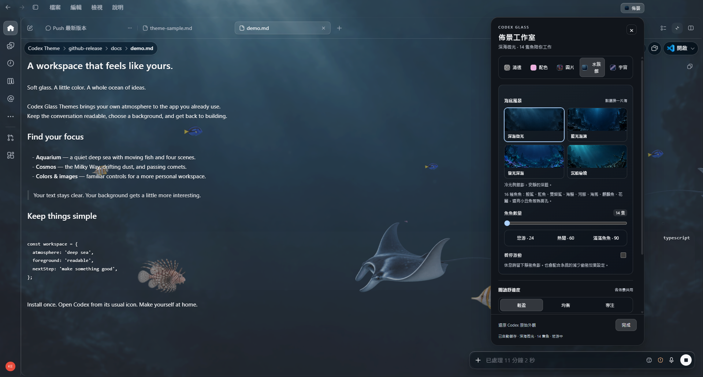
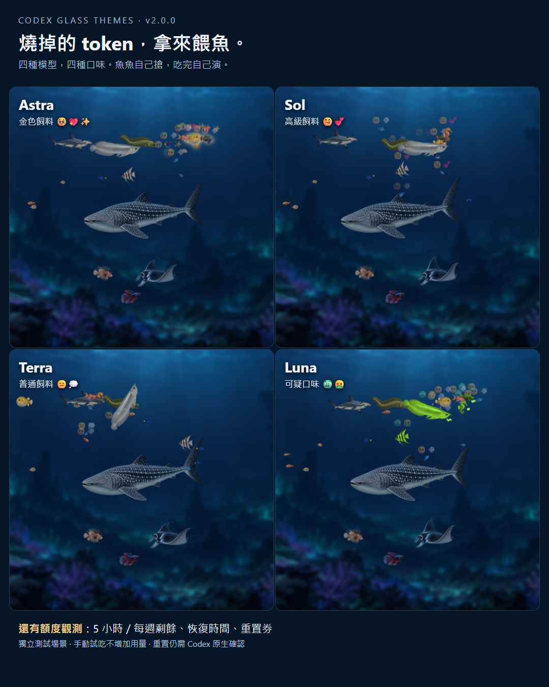
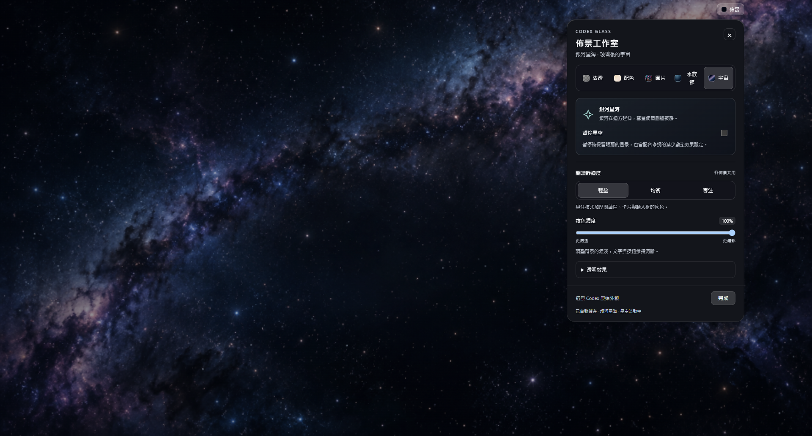

# Codex Glass Themes

**一點玻璃、一點色彩，讓工作空間更像你。**

[English](README.md) · [繁體中文](README.zh-TW.md) · [下載 v2.0.1 EXE](https://github.com/mabyes1/codex-glass-themes/releases/download/v2.0.1/ChatGPT-Glass-Themes-Setup-2.0.1-win-x64.exe) · [從原始碼建置](packaging/README.md#繁體中文)

替 Windows Codex 換上喜歡的氣氛：清透玻璃、自己的照片、安靜的深海，或緩緩流動的銀河。背景可以有個性，文字依然清楚；設定會自動保存，平常照樣使用原本的 Codex 圖示開啟。

*實際 Windows Codex 介面，畫面中是公開的[示範文件](docs/demo.md)。四種海底場景、魚群密度與暫停開關，都在同一個面板裡。*

## v2.0.1：修正背景助手越開越多

大型聊天紀錄可能拖慢助手啟動，讓外層監看程式反覆開出新助手。這版在初始化前就取得單一實例鎖、登記 PID，也會記住正在啟動的程序。Token 讀取進度按 session 保存；沒有進度的舊紀錄只讀最後 256 KiB，所有 session 每輪合計最多讀 2 MiB。

**已安裝 v2.0.0：** [下載修復 ZIP](https://github.com/mabyes1/codex-glass-themes/releases/download/v2.0.1/glass-theme-helper-repair-2.0.1.zip)，解壓縮後，用原本安裝佈景的 Windows 帳戶執行 `Repair.cmd`。工具會備份修改的檔案、清掉該安裝的重複助手，保留 Codex、主題偏好與桌布。[更新說明與自訂路徑用法](docs/releases/v2.0.1.md)。

## v2.0.0：燒掉的 token，拿來餵魚

**[播放／下載 33 秒四格示範影片](https://github.com/mabyes1/codex-glass-themes/releases/download/v2.0.0/codex-glass-themes-v2.0.0-four-feeds.mp4)** · [更新說明](docs/releases/v2.0.0.md)

- **Token 飼料：** 讀本機 Codex 新增用量，各模型累積每 10,000 tokens 掉一顆。Astra 🥹💖✨、Sol 😋💕、Terra 😑💭、Luna 🤢🤮；Luna 吃完會變綠、吐出碎屑，幾秒後恢復。
- **真的會搶：** 每顆最多三隻魚競爭，嘴先靠近並開始吸入的魚吃到；落敗的魚撲空、停一下，帶著 🥺💨 游開。銀龍轉向較慢，偶爾被小魚搶先。
- **手動試吃：** 「佈景 → 水族館 → 手動試吃」可選四種口味，一次六顆，不增加 token 計數。
- **額度觀測：** 頂部顯示 5 小時／每週剩餘比例與重置券數量，滑鼠移上去看恢復時間。點擊進原生用量明細；重置券仍走 Codex 原生確認流程。
- **保留效果的優化：** 未變動的紀錄不讀內容、無關工具輸出不解析；emoji 與飼料使用小型快取，選魚只保留最近三名。魚數、24 FPS 上限和搶食效果都保留。

影片使用獨立測試場景與手動飼料，沒有消耗模型用量，也沒有錄入聊天或帳號資料。Token 計數從助手啟動後累積，重啟會歸零；它與帳號額度百分比是不同資料。[完整計數與搶食規則](docs/token-feeding.md)。

## 想換什麼氣氛？

| 模式 | 可以調整什麼 |
| --- | --- |
| **清透** | 中性的玻璃背景，以及獨立的背景濃度。 |
| **配色** | 六組預設色盤，從奶油晨光、抹茶到深藍與紫霧；底色及兩側光暈都能微調。 |
| **圖片** | 使用自己的 PNG、JPG、WebP 或 AVIF，每張最大 12 MB，圖片保存在本機。 |
| **水族館** | 四種深海場景、十六種魚、14–90 個游動位置、氣泡與暫停開關。 |
| **宇宙** | 銀河、閃爍星點、漂浮塵光，以及偶爾劃過的彗星。 |

### 白天的暖色，深夜的星空

*選一組喜歡的起點，再慢慢調成自己的配色。背景濃度與閱讀表面分開控制。*

*宇宙有自己的夜色濃度與暫停設定。這兩張設定截圖暫時隱藏了對話內容以保護隱私；背景與面板都來自實際執行中的程式。[截圖說明](docs/images/README.md)。*

切換到其他模式、隱藏視窗、手動暫停，或啟用系統的減少動態效果後，動畫會停止。水族館最高 24 FPS，宇宙最高 18 FPS。水族館是混合淡水與海水生物的幻想場景；環境及魚群素材由 AI 生成，[美術提示詞](docs/art/)也包含在專案中。

## 開始使用

先安裝官方 **Windows x64 Codex，套件名稱為 `OpenAI.Codex`**，並使用平常操作 Codex 的 Windows 帳戶安裝主題。

| 版本 | Windows 支援範圍 |
| --- | --- |
| **v2.0.1／最新原始碼** | Windows 10 22H2 / Windows 11，組建 19045 以上。低於 22621 使用不透明視窗內的模擬玻璃。 |
| **較舊的 v1.2.0 安裝檔** | Windows 11 x64，組建 22621 以上。這份舊安裝檔尚未包含 Windows 10 相容模式。 |

Windows 11 22621 以上使用原生背景效果。較舊的支援版本會柔化視窗內的佈景，不會透出或模糊桌面。此安裝包不支援 ARM64。

1. [下載 v2.0.1 安裝檔](https://github.com/mabyes1/codex-glass-themes/releases/download/v2.0.1/ChatGPT-Glass-Themes-Setup-2.0.1-win-x64.exe)，或[從原始碼建置](packaging/README.md#繁體中文)。
2. 使用自己的普通 Windows 帳戶執行，按 **「安裝並啟用」**。預設位置是 `%USERPROFILE%\CodexGlass`。
3. 若安裝時 Codex 已經在執行，先完成手上的工作，再**完整退出一次**，然後從原本的開始功能表或工作列圖示開啟。
4. 點視窗上方的 **「佈景」**，選擇喜歡的模式。

安裝包已內附 Node.js，一般使用者不必安裝開發工具，也不需要管理員權限。安裝程式目前尚未簽署，Windows 可能顯示未知的發行者。使用期間請保留安裝目錄。

v2.0.0 升級這份助手修正，使用上面的修復 ZIP。已經使用其他版本或開發助手？請先用原安裝的移除或還原功能解除。遇到其他安裝留下的登入或除錯設定，安裝器會顯示衝突，不直接覆寫。

## 幾個好用的控制項

- **保持前景清晰：** 調整背景時，文字與按鈕維持不透明。關閉後可使用整窗透明度，但文字也會一起變透明。
- **閱讀舒適度：** 加厚內容區、卡片及輸入框的底色，讓閱讀更穩定。
- **還原 Codex 原始外觀：** 立即移除目前佈景，背景助手仍然保留。

設定保存在原本的 Codex 瀏覽器資料中；圖片存於本機 IndexedDB。本專案沒有雲端桌布服務，也不會上傳你選擇的背景圖片。

## 更新與解除安裝

助手每五秒查詢官方 Codex 套件及更新狀態。最新原始碼會在登入時啟動助手，並提供每分鐘的恢復觸發，避免助手結束後一直離線。如果 Codex 比回呼更早啟動，該實例仍可能需要完整退出再開；應先確認它真的缺少 CDP 啟動參數，不能只因視窗載入比較慢就要求重開。

v2.0.1 修復 ZIP 可直接更新現有 v2.0.0 安裝。其他完整版本更新目前採 **先解除安裝，再安裝新版**。到 **設定 → 應用程式 → 已安裝的應用程式 → ChatGPT Glass Themes（Codex）→ 解除安裝**，再執行新安裝檔。個人配色與圖片會保留在 Codex 資料中。移動或刪除安裝目錄前，請先解除安裝。

## 主題沒出現時

最新原始碼會針對「原生視窗尚未就緒」自動重試，回到視窗時也能再次套用。先看真正卡住的位置，再決定是否需要重開：

| 安裝目錄 `.runtime-auto/` 內的檔案 | 用途 |
| --- | --- |
| `watcher-health.json` | 確認更新時間及助手 PID。舊的 `armed` 檔案不代表助手現在還活著。 |
| `attach-status.json` | 區分等待 CDP、主畫面、主題及原生背景；原生失敗另有狀態。 |
| `host-error.log` | 查看失敗的原生指令及重試紀錄。 |
| `startup-trace.jsonl` | 確認啟動哪個階段耗時。 |

只有確認執行中的程式缺少 CDP 啟動參數時，才在助手就緒後完成工作、完整退出並重開。反覆重裝或重啟，無法解釋一次原生背景套用失敗。[這次的原因、修正與驗證](docs/startup-recovery.md)。

[回報 BUG](https://github.com/mabyes1/codex-glass-themes/issues) 時，請附上 Windows 組建、Codex 版本、使用的原始碼或發布版本，以及相關錯誤。分享前先檢查紀錄，其中可能含本機路徑及程序資訊。

## 目前驗證到哪裡？

v2.0.0 通過 **37 項 Node 測試、42 個 Chromium 檢查、13 項獨立安裝器檢查**。真實 Codex renderer 已驗證 token 自動餵食、手動試吃、搶食、落敗反應與 Luna 嘔吐。[v2.0.0 驗證結果](docs/releases/v2.0.0.md)及歷史[啟動驗證](docs/startup-recovery.md#verification)。

安裝器檢查包含解包／部署、原生助手與套件位置查詢、衝突保護和移除。完整登出／登入、一般冷啟動，以及另一台乾淨 Windows 10／11 電腦的安裝、啟動、移除仍未完成實機驗收。瀏覽器檢查使用替代的原生橋接，不能代替 Windows DWM 實機結果。

## 它如何運作？

這是獨立社群工具，與 OpenAI 無隸屬關係。支援的是官方 `OpenAI.Codex` 套件內的 `ChatGPT.exe`；其他產品即使執行檔同名，也不屬於支援範圍。

目前帳戶的背景助手透過 Windows 套件除錯回呼，在新啟動時加入本機 loopback CDP 參數。主題程序負責樣式，支援的系統再套用原生視窗效果；不修改官方套件檔案。套件除錯模式會影響 Windows 的暫停、恢復與終止行為，細節見 [Microsoft 文件](https://learn.microsoft.com/en-us/windows/win32/api/shobjidl_core/nf-shobjidl_core-ipackagedebugsettings-enabledebugging)。

原始碼目錄、建置指令、回復邊界與內附 Node.js 授權，請見 **[建置與測試](packaging/README.md#繁體中文)**。
